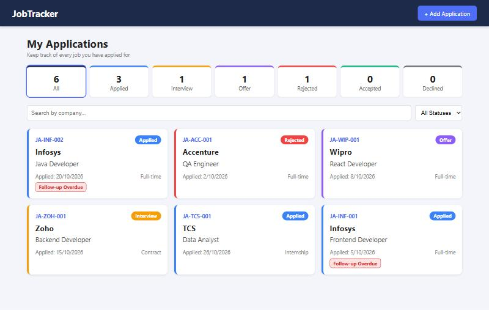
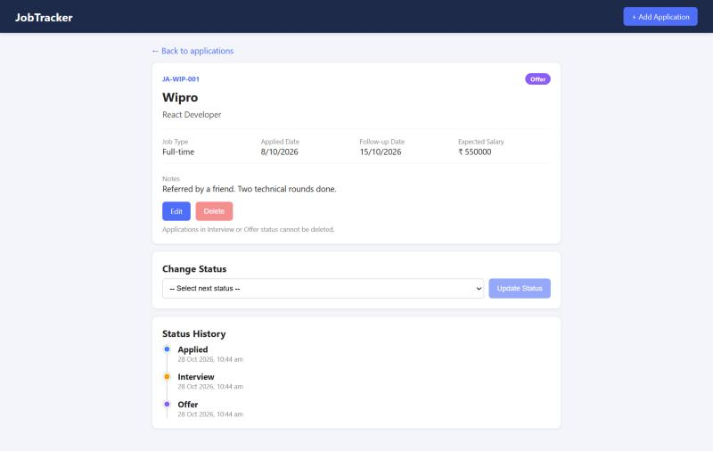

# Job Application Tracker (MERN)

A web app for job seekers to record the jobs they applied for and track each application through its stages.

Built with MongoDB Atlas, Express.js, React (Vite) and Node.js.

## Screenshots

**Applications list** - status counts, filter, search, coloured status badges and the Follow-up Overdue badge



**Application details** - details, next status dropdown, disabled delete (Offer status) and status history timeline



## Project Structure

```
project-root/
├── backend/
│   ├── models/        Application.js, Counter.js
│   ├── routes/        applications.js
│   ├── utils/         helpers.js
│   ├── .env
│   └── server.js
├── frontend/
│   └── src/
│       ├── pages/     home.jsx, appform.jsx, details.jsx
│       ├── api.js
│       ├── App.jsx
│       └── index.css
└── screenshots/
```

## How to Run

Backend (runs on http://localhost:5000):

```bash
cd backend
npm install
npm start
```

Frontend (runs on http://localhost:5173):

```bash
cd frontend
npm install
npm run dev
```

The `.env` file in `backend/` is included and has `PORT` and `MONGO_URI` (a test MongoDB Atlas database made for this exam).

## APIs

Base URL: `http://localhost:5000/api/applications`

Every response has the format `{ success, message, data }`.

| Method | Endpoint | Description | Status codes |
|---|---|---|---|
| POST | `/` | Add a new application | 201, 400, 409 |
| GET | `/` | Get all applications with count per status. Query params: `status`, `search` | 200 |
| GET | `/:id` | Get one application with status history and valid next statuses | 200, 404 |
| PUT | `/:id` | Edit company, role, job type, salary and notes | 200, 400, 404, 409 |
| PATCH | `/:id/status` | Change status (only valid transitions allowed) | 200, 400, 404 |
| DELETE | `/:id` | Delete application (not allowed in Interview or Offer) | 200, 400, 404 |

### Example requests

Add application:

```json
POST /api/applications
{
  "company": "Infosys",
  "role": "Frontend Developer",
  "jobtype": "Full-time",
  "applieddate": "2026-10-05",
  "salary": 600000,
  "notes": "Applied through careers page"
}
```

Filter and search:

```
GET /api/applications?status=Applied&search=info
```

Change status:

```json
PATCH /api/applications/:id/status
{ "status": "Interview" }
```

## Features and Rules

- **Application ID** is generated by the backend as `JA-<first 3 letters of company>-<3 digit number>` (e.g. `JA-INF-004`). The number increases per company prefix and the client cannot set it.
- **Applied Date** cannot be a future date (checked on frontend and backend). It cannot be edited after creation.
- **Status workflow:**
  - Applied → Interview or Rejected
  - Interview → Offer or Rejected
  - Offer → Accepted or Declined
  - Rejected, Accepted and Declined are final
  - Invalid changes return 400. The frontend dropdown only shows valid next statuses.
- **Status history** is saved with date and time on every change and shown as a timeline.
- **Follow-up date** is set to 7 days after the applied date. If it has passed and the status is still Applied, the API returns `isOverdue: true` and the card shows a red "Follow-up Overdue" badge.
- **Duplicate rule:** the same company and job role (case-insensitive) cannot be added while an earlier one is still active. Returns 409 and the message is shown on the form.
- **Delete rule:** only allowed in Applied or a final status. Interview and Offer return 400, and the Delete button is disabled. Deleting asks for confirmation.
- **Responsive UI** for mobile, tablet and desktop.
